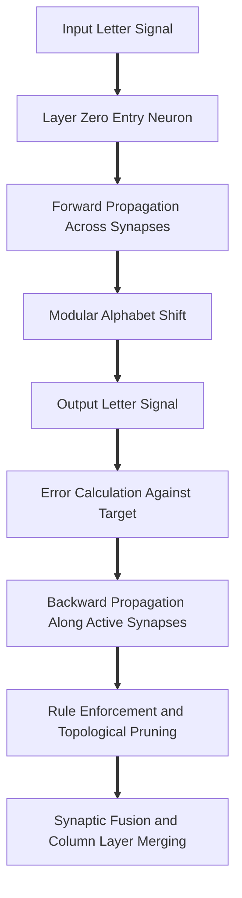
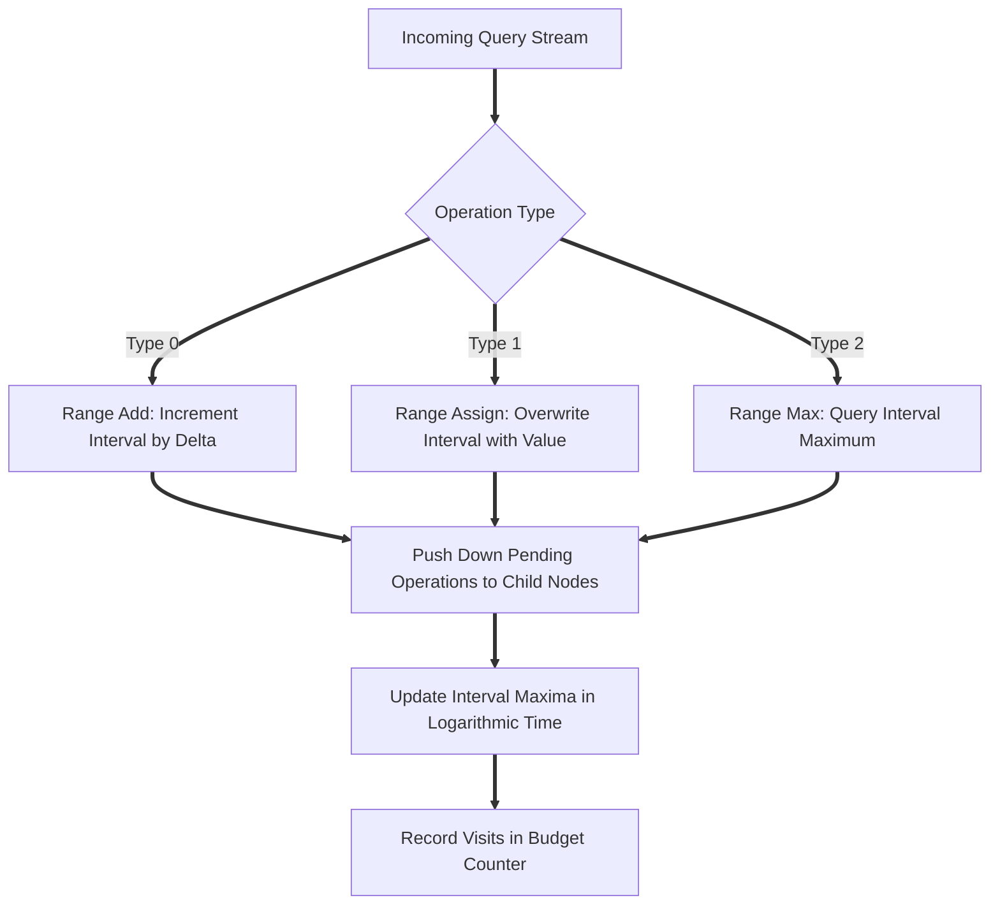
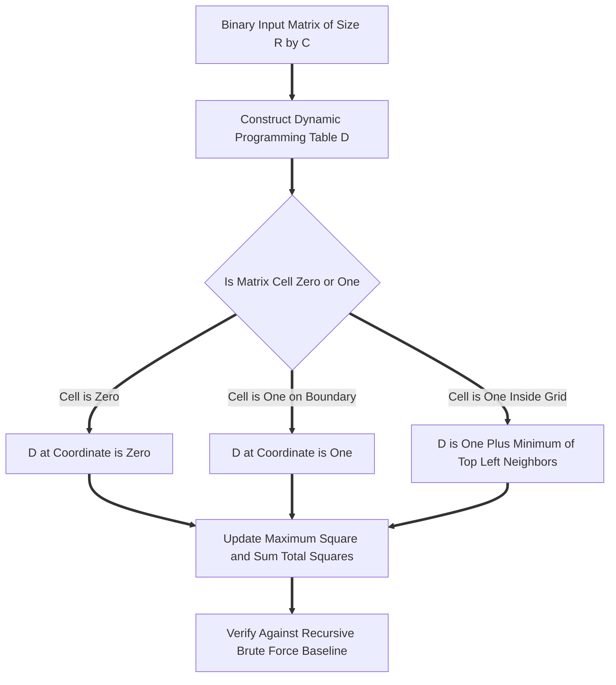

# Advanced Data Structures and Computational Substrates

Special thanks to Hamza and Shamir for making that assignment.

## Section 1: Question 1: Bio Inspired Sparse Neural Mesh Architecture

This project investigates a bio inspired sparse neural mesh substrate rather than a conventional static layer network. The architecture models physical neural tissue organized across three dimensions. Neurons occupy planar two dimensional grids of size N by N, linked horizontally and vertically through local cardinal neighbors. Successive planar grids connect along the vertical depth axis through directed synaptic axonal projections.

### File Breakdown for Question 1

1. Q1/headers/neuron.h

The neuron header defines the individual computational unit within the neural mesh. Each neuron stores an integer identifier, a floating point weight value, and four spatial pointers pointing to adjacent cardinal neighbors: up, down, left, and right. It also maintains a singly linked list of outgoing axonal synapses through a headAxon pointer. Comprehensive constructors, accessors, and mutators provide full encapsulation for lattice operations.

2. Q1/headers/synapse.h

The synapse header implements directed axonal pathways connecting neurons across consecutive layers. Every synapse records its transmission weight, a boolean activation flag indicating whether it carried a signal during the most recent forward propagation cycle, a pointer to the destination target neuron, and a pointer to the subsequent synapse in the linked list.

3. Q1/headers/layer.h

The layer header represents a single planar N by N grid slice in the vertical hierarchy. It tracks the lattice dimension N, total capacity, the current count of active neurons, a unique layer identifier, an anchor pointer to the top left neuron, and a pointer to the subsequent layer in the doubly linked vertical chain.

4. Q1/headers/map.h

The map header declares the primary NeuroMesh orchestrator class. It coordinates the overall neural substrate by storing pointers to headLayer and tailLayer, the global dimension N, pruning and fusion threshold values, tracking variables for propagation history, and member function declarations for insertion, deletion, pruning, fusion, inspection, and signal flow.

5. Q1/headers/meshFileReader.h

The file reader header encapsulates single pass ingestion from persistent storage. The loadFromFile member function opens the specified data file only once, extracts global parameters including dimension size N, pruning threshold, and fusion threshold from the opening line, and sequentially instantiates neurons with their respective weights until the data stream terminates.

6. Q1/headers/meshLifecycleManager.h

The lifecycle manager implements dynamic structural adaptations and memory governance. It handles progressive insertion into grid slots, pruning of sub threshold neurons, cascading neighbor link adjustments, synaptic fusion based on connection strengths, column and layer merges when density conditions are met, synapse rewiring across layers, and complete deallocation of dynamically allocated nodes during mesh destruction.

7. Q1/headers/propagationEngine.h

The propagation engine drives signal dynamics through the substrate. Forward propagation accepts an input character, traces highest weight active synaptic paths through successive layers, modifies the character using modular base twenty six arithmetic, and marks active conduits. Backward propagation computes the error residual between actual and target characters, distributes corrective adjustments backward along the active path, and invokes rule enforcement to trigger self organizing structural adaptations.

8. Q1/headers/meshInspector.h

The inspector header provides diagnostic utilities and interactive inspection tools. It contains functions to print complete layer grids, serialize the entire mesh topology to text files, perform spatial searches by coordinate or identifier, output single neuron status with all neighbor and axon links, and run an interactive terminal traversal allowing manual navigation across layers, rows, and columns.

9. Q1/headers/visualizer.h

The visualizer header implements a graphical interface using the SFML graphics library. It constructs an interactive visual dashboard displaying neural layers in spatial perspective, highlighting active synaptic pathways, animating propagation pulses, and offering graphical modal dialogs for real time mesh inspection and mutation.

10. Q1/cpp/main.cpp

The main source file serves as the system execution driver. It presents a clean choice between the interactive terminal menu featuring sixteen operational commands and the SFML graphical visualizer.

## Section 2: Question 2: Dynamic Segment Tree with Lazy Propagation

Question 2 implements an algorithmic segment tree data structure capable of performing range additions, range assignments, and range maximum queries over an array of one hundred thousand elements across one hundred thousand operations while strictly obeying an operation visit budget.

### File Breakdown for Question 2

1. q2/Array.h

The array header defines a generic memory utility named AhmadArray. It provides templated functions to initialize and delete dynamically allocated buffers.

2. q2/budget.h

The budget header defines telemetry namespaces that monitor algorithmic performance. The budget namespace tracks total visits during query operations, while the bildOne namespace records visits during initial tree construction. This ensures the operations remain within the allotted budget of eighty visits per query on average.

3. q2/ProvidedHash.h

The provided hash header contains a deterministic pseudo random number generator using fixed multiplier and increment constants. It yields repeatable sequences of numbers to drive large scale stress tests and performance benchmarking.

4. q2/build.h

The build header is the foundation of the segment tree. It manages four primary arrays sized to four times the input size: updatedArray for segment maxima, addArray for lazy addition deltas, assignArray for lazy assignment values, and hasAssign for tracking active assignment tags. It provides recursive tree construction in linear time, lazy push down mechanisms, and heap cleanup routines.

5. q2/RangeAdd.h

The range add header implements interval addition. It identifies whether the query range is outside, fully encompassing, or partially overlapping the current node segment. For full overlaps, it applies the addition directly and caches the lazy delta. For partial overlaps, it pushes down pending adjustments to children, recurses into both halves, and updates the segment maximum.

6. q2/rangeAssign.h

The range assign header implements interval value overwrites. An assignment supersedes any pending addition tags on the node, stores the new value in the lazy assignment buffer, and propagates values down the tree branches during subsequent partial traversals.

7. q2/rangeMax.h

The range max header computes the maximum element across any arbitrary subsegment. When querying disjoint intervals it returns the minimum possible value, while for full overlaps it immediately returns the stored segment maximum. Partial overlaps recurse into both children and return the greater of the two outcomes in logarithmic time.

8. q2/main.cpp

The main test driver seeds the random generator, constructs an array of one hundred thousand random integers, builds the segment tree, and executes one hundred thousand mixed operations. It computes a cumulative checksum, monitors visit counts, and validates that total visits satisfy the performance budget.

## Section 3: Question 3: Maximal and Total All Ones Square Submatrices via Dynamic Programming

Question 3 addresses optimal submatrix discovery in binary grids. Given an R by C binary matrix containing zeros and ones, the objective is to locate the largest square submatrix containing exclusively ones, compute its coordinates, and determine the aggregate count of all valid all ones square submatrices of any dimension.

### File Breakdown for Question 3

1. q3/rng.h

The random number generator header provides state initialization and generation routines for generating randomized binary test matrices of varying dimensions.

2. q3/functionGetMin.h

This header provides utility functions that calculate the minimum of two integers, the minimum of three integers, and an in place integer swap routine utilizing bitwise exclusive or operations.

3. q3/function1.h

The function one header implements the largest ones square algorithm using dynamic programming. It allocates a table where each cell records the side length of the largest all ones square whose bottom right corner terminates at that coordinate. By evaluating the recurrence relation considering the cell above, the cell to the left, and the diagonal top left cell, it identifies the maximum square side length and its top left bounding coordinates in linear time with respect to total cells.

4. q3/function2.h

The function two header implements the count ones squares algorithm. Because each cell entry in the dynamic programming table directly reflects the number of all ones squares of various sizes that share that cell as their bottom right corner, summing all entries across the entire table produces the exact count of all valid all ones squares in linear time.

5. q3/function3.h

The function three header implements a brute force verification oracle. It systematically inspects every possible square dimension across every row and column, using recursive helper functions to verify that every cell within the square boundary contains a one. This guarantees absolute correctness for cross testing.

6. q3/test.h

The test header defines a verification harness. It executes a self check on an all ones matrix of dimension one thousand by one thousand to verify that the computed total matches the exact expected theoretical value of three hundred thirty three million eight hundred thirty three thousand five hundred. It then runs two thousand randomized tests comparing the dynamic programming output directly against the brute force oracle.

7. q3/main.cpp

The main execution file instantiates the Test harness and runs both the self check and the randomized oracle cross validation tests to confirm mathematical precision.
